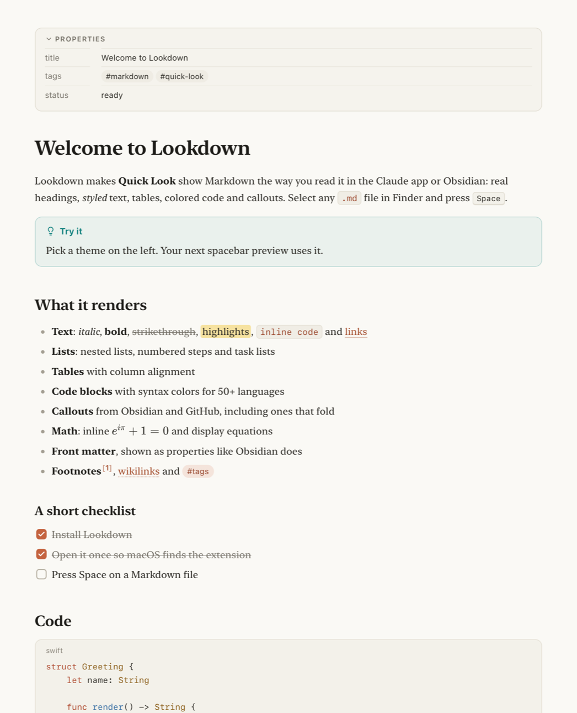
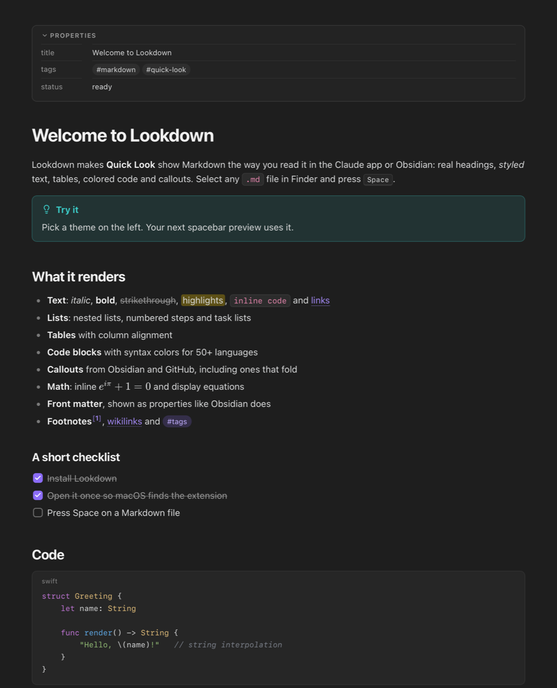

# Lookdown

Readable Markdown in Finder's Quick Look. Select a `.md` file and press Space: instead of plain
text you get real headings, styled text, tables, colored code, callouts and math, styled like the
Claude app, Obsidian or GitHub.

<p>
  
  
</p>

It's a Quick Look extension inside a small app. The app is only for settings; you don't need to
keep it open.

## Download

Get **Lookdown-1.0.dmg** from [Releases](https://github.com/rgbwavesdev/Lookdown/releases/latest).
It's signed and notarized by Apple, needs macOS 14 or later, and runs on Apple silicon and Intel
(the Intel build hasn't been tested on an Intel Mac yet).

1. Open the disk image and drag **Lookdown** into **Applications**.
2. Open Lookdown once. When macOS asks about an app downloaded from the internet, click **Open**.
   Its window should say the Quick Look extension is on.
3. Select a Markdown file in Finder and press Space.

## Settings

Open Lookdown to choose:

- **Theme**: Warm (serif on ivory, like the Claude app), Clean (Obsidian style) or GitHub
- **Appearance**: System, Light or Dark. System follows macOS's light or dark mode.
- **Text size** and **width**
- **Single line breaks start a new line**: Obsidian's behavior. Off follows GitHub/CommonMark.
- **Front matter**: shown as an Obsidian-style Properties box, collapsed, or hidden
- **Load images from the web**: off shows a placeholder instead of fetching remote images

The window has a live preview of a sample document; drop any Markdown file on it to try your own.
Settings are saved to `~/Library/Application Support/Lookdown/settings.json`, which the extension
reads before every preview, so changes apply to the next spacebar press.

## What it renders

- CommonMark plus GitHub extras: tables, task lists, strikethrough, autolinks
- Footnotes, `==highlights==`, raw HTML (`<details>`, `<kbd>`, ``, centered blocks)
- Code with syntax colors for about 50 languages (highlight.js); the language or file name
  (`ts title="app.ts"`, `python:script.py`) shows above each block
- Math with KaTeX: `$…$`, `$$…$$`, `\(…\)`, `\[…\]` and ```` ```math ```` blocks. Prices like
  "$5 and $10" stay text.
- Callouts from Obsidian (`> [!tip] Title`, foldable with `+`/`-`) and GitHub (`> [!NOTE]`)
- Obsidian `[[wikilinks]]`, `![[image.png|300]]` embeds (found anywhere in the vault), `#tags`,
  task states `[-]` and `[/]`
- Local images next to the file, inlined into the preview

Quick Look runs no scripts, so Mermaid diagrams show as their source, code blocks have no copy
button, and wikilinks are styled but not clickable.

Supported file extensions: `.md`, `.markdown`, `.mdown`, `.mkd`, `.mkdn`, `.mdwn`, `.mdtxt`,
`.mdtext`, `.rmd`, `.qmd`.

## Build from source

```bash
./build.sh
```

This needs only the Command Line Tools (`xcode-select --install`); Xcode isn't required. It signs
with your Developer ID certificate if the keychain has one (otherwise Apple Development, or ad
hoc), installs `~/Applications/Lookdown.app` and registers the extension. The next spacebar preview
of a Markdown file uses it.

### Packaging a release

```bash
./build.sh --package
```

This builds for Apple silicon and Intel and writes `dist/Lookdown 1.0.dmg`: the app, an
Applications shortcut and a Read Me with install steps. The installed copy isn't touched.

- With a **Developer ID Application** certificate in the keychain and a notarytool profile named
  `notary`, the app and the disk image are signed, notarized and stapled, so people just click
  Open. Create the profile once (it asks for an app-specific password and keeps it in the
  keychain):

  ```bash
  xcrun notarytool store-credentials notary --apple-id you@example.com --team-id ABCDE12345 --keychain ~/Library/Keychains/login.keychain-db
  ```

  Keep the `--keychain` part: the build looks for the profile in the login keychain file. Without
  it, notarytool uses a hidden part of the keychain, where a saved profile once vanished within
  minutes.

- Without them, the package is signed ad hoc and its Read Me walks people through
  Privacy & Security → Open Anyway.

Every build uses the hardened runtime (which notarization requires) with the JIT entitlement:
without it JavaScriptCore only interprets, and big files take about 4× longer.

## How it works

| Path | Role |
| --- | --- |
| `Sources/Preview/PreviewProvider.swift` | Data-based Quick Look extension: returns one finished HTML page |
| `Sources/Shared/Renderer.swift` | Runs markdown-it in JavaScriptCore, then inlines styles, images (data URIs) and KaTeX fonts |
| `Sources/Shared/Settings.swift` | Settings model and the JSON file both sides share |
| `Resources/lookdown.js` | markdown-it setup and Lookdown's plugins: callouts, tasks, wikilinks, tags, math, front matter |
| `Resources/lookdown.css`, `themes.css` | Base styles; each theme has `base`, `light` and `dark` sections |
| `Sources/App/` | Settings window with live preview, plus the command-line test modes |
| `Info/` | Info.plists and entitlements |
| `Packaging/` | The Read Me files that go into the disk image |

Everything is inlined because Quick Look's web view can't load files next to the page. A
Content-Security-Policy blocks all scripts, and `<script>`, `<iframe>` and similar tags are
stripped too. The extension is sandboxed with read-only access to the disk (for images and the
settings file).

## Testing

```bash
L=~/Applications/Lookdown.app/Contents/MacOS/Lookdown
$L --render test/kitchen-sink.md -o /tmp/out.html            # HTML, with timing
$L --snapshot test/kitchen-sink.md /tmp/out.png --full       # WebKit render to PNG, off-screen
$L --snapshot file.md out.png --theme clean --appearance dark --size 300x900
$L --quicklook file.md 10   # loads it through the real extension, off-screen, for 10 s
```

`test/kitchen-sink.md` exercises every feature. `--quicklook` uses the system's `QLPreviewView`,
the same path as Finder's spacebar preview; read what it rendered through accessibility. Don't use
`qlmanage -p` on macOS 27: it crashes for every preview extension, Apple's included.

The extension logs each preview:

```bash
/usr/bin/log show --last 5m --info --predicate 'subsystem == "com.zachburkhart.Lookdown"'
```

## Troubleshooting

- **Still plain text:** open Lookdown once and check that its status says the extension is on.
  If not, turn on Lookdown under System Settings → General → Login Items & Extensions → Quick Look.
  Then run `qlmanage -r`.
- **Plain text after installing a differently signed build:** macOS ties the extension's sandbox
  folder to whoever signed the build that created it, and won't let another signer use it. The
  log then shows "not in ACL for container" from `secinitd`. Move
  `~/Library/Containers/com.zachburkhart.Lookdown.Preview` to the Trash (it holds no settings) and
  preview again.
- **Uninstall:** delete Lookdown from Applications and run `qlmanage -r`.

## License

Copyright © 2026 Zach Burkhart.

Lookdown is free software: you can redistribute it and/or modify it under the terms of the
[GNU General Public License](LICENSE) as published by the Free Software Foundation, either version
3 of the License, or (at your option) any later version. It is distributed in the hope that it will
be useful, but WITHOUT ANY WARRANTY; without even the implied warranty of MERCHANTABILITY or FITNESS
FOR A PARTICULAR PURPOSE. See the license for details.

## Third-party code

markdown-it 14.1.0, markdown-it-footnote 4.0.0 and markdown-it-mark 4.0.0 (MIT), highlight.js
11.12.0 (BSD-3-Clause), KaTeX 0.19.1 (MIT), and icon paths from Lucide (ISC). They keep their own
licenses, which are in `Resources/vendor/licenses` and ship inside the app.
