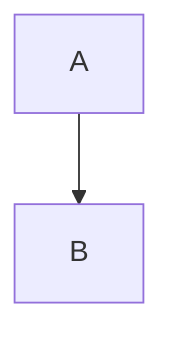

Setext heading
==============

Second level setext
-------------------

# H1 with `code` and a [link](https://example.com)
## H2
### H3
#### H4
##### H5
###### H6

Inline: *em*, _em_, **strong**, __strong__, ***both***, ~~strike~~, ==mark==, `code`, <kbd>⌘</kbd> + <kbd>Space</kbd>, H<sub>2</sub>O, x<sup>2</sup>.
Autolinks: <https://example.com>, https://bare.example.com/path?q=1#frag, www.example.org, and mail@example.com.
Hard break with backslash\
and with two spaces  
done. Emoji stay as-is: 🚀 :smile:

Tags: #project #nested/tag #tag-with-dash, but not #123, C#, issue#9 or [anchor](#h2).
Wikilinks: [[Home]], [[Home|alias]], [[Home#Section]], [[#Local heading]], [[Folder/Note.md]].

## Math

Inline $a^2 + b^2 = c^2$, display-inline $$\sum_{i=1}^n i$$, brackets \(x_1\), and money: it costs $5 and $10, or $5-$10, or \$20.

\[
\nabla \cdot \vec{E} = \frac{\rho}{\varepsilon_0}
\]

$$
\begin{aligned}
f(x) &= (x+1)^2 \\
     &= x^2 + 2x + 1
\end{aligned}
$$

```math
E = mc^2
```

Broken math: $\frac{1}{$ stays text-ish, and $\badcommand{x}$ shows an error.

## Callouts

> [!NOTE]
> GitHub note alert.

> [!TIP]
> GitHub tip.

> [!IMPORTANT]
> GitHub important.

> [!WARNING]
> GitHub warning.

> [!CAUTION]
> GitHub caution.

> [!info] Custom **bold** title with `code`
> Body with a list:
> - one
> - two

> [!success] Done
> [!question]+ Open by default
> Text right after.

> [!question]+ Foldable, open
> Expanded content.

> [!example]- Foldable, closed
> Hidden content.

> [!danger]
> > [!bug] Nested bug inside danger
> > Nested body.

> [!quote] Title only

> [!unknowntype] Unknown type falls back to note style

> [!abstract] Abstract
> [!todo] is just text here.

> [!failure] Failure
> Something broke.

> Plain quote
> > Nested plain quote

## Lists

3. Starts at three
4. Four
   1. Nested ordered
   2. Second
      - Mixed bullet
        - Deeper bullet
5. Five

- Loose list item one

- Loose list item two

  With a second paragraph.

- [ ] Todo
- [x] Done
- [X] Done uppercase
- [-] Cancelled
- [/] In progress
- [ ] Parent task
  - [ ] Child task
  - [x] Child done
    - Plain sub-bullet
- [link](https://example.com) item that starts with a link
- [not a task] bracket text

1. [ ] Ordered task
2. [x] Ordered done

## Code

```js
const greet = (name) => `Hello, ${name}!`; // comment
export default { greet, answer: 42, ok: true };
```

```python
def fib(n: int) -> int:
    """Return the nth Fibonacci number."""
    return n if n < 2 else fib(n - 1) + fib(n - 2)
```

```diff
- removed line
+ added line
  unchanged
```

```json
{ "name": "lookdown", "version": "1.0.0", "private": true, "list": [1, 2, null] }
```

```yaml
key: value
list: [a, b]
```

```html
<div class="x" id="y">Hi &amp; bye</div>
```

```sql
SELECT id, name FROM users WHERE created_at > NOW() - INTERVAL '1 day';
```



```unknownlang
plain text in an unknown language
```

```
no language at all
```

```ts title="src/app.ts"
let x: number = 1;
```

```python:script.py
print("filename after colon")
```

    indented code block
    second line

```text
A very long line that should scroll horizontally rather than wrap: aaaaaaaaaaaaaaaaaaaaaaaaaaaaaaaaaaaaaaaaaaaaaaaaaaaaaaaaaaaaaaaaaaaaaaaaaaaaaaaaaaaaaaaaaaaaaaaaaaaaaaaaaaaa
```

## Tables

| Left | Center | Right | `code` | Link |
|:-----|:------:|------:|--------|------|
| a | b | c | `x = 1` | [here](https://example.com) |
| longer cell text that wraps maybe | **bold** | 1,234.56 | | |

| A | B | C | D | E | F | G | H | I | J | K | L |
|---|---|---|---|---|---|---|---|---|---|---|---|
| wide table column one | two | three | four | five | six | seven | eight | nine | ten | eleven | twelve |

## Images

Relative: 

With spaces (encoded):  and angle brackets: 

Obsidian size: 

Obsidian embed: ![[icon.png]] and sized ![[icon.png|48]] and note embed ![[Some Note]] and heading embed ![[Some Note#Part]]

Missing: 

Remote: 

HTML image: 

<p align="center"><br><em>Centered with HTML</em></p>

## HTML

<details>
<summary>Click to expand</summary>

Hidden **markdown** inside details.

</details>

<script>document.body.innerHTML = "HACKED";</script>
<iframe src="https://example.com"></iframe>
<div onclick="alert(1)">A div with an onclick (scripts are blocked anyway).</div>

<!-- an HTML comment should not show -->

## Footnotes

A claim[^one], another[^named], and the first again[^one].

[^one]: First footnote with `code`.
[^named]: Named footnote with a [link](https://example.com).

***

Final paragraph after a starred rule.
